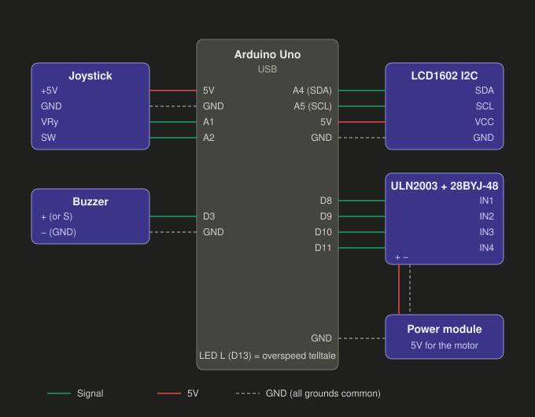

# arduino-autosar-cluster

A mini **AUTOSAR Classic instrument cluster** on an Arduino Uno (ATmega328P), written bare metal in C. It does not use the Arduino core. Every layer is hand written, from the MCAL register drivers up to the application SWCs, and the RTE is generated from an ARXML model by arxml2rte, my own small RTE generator (a separate repository, not public yet). The generated RTE is committed in `src/Rte`, so the project builds without it.

It uses only parts from the Keywish RFID starter kit:

- a joystick as the accelerator and brake pedals
- a 28BYJ-48 stepper motor as the speedometer needle
- the LCD1602 with I2C backpack (PCF8574) for speed, odometer and trip
- the on-board LED and the kit's passive buzzer for the speed warning

## What it does

| At power-on | While driving |
|---|---|
| The LCD shows a start screen for 1.5 s | Joystick up = throttle, down = brake, centre = coasting |
| A 0.3 s beep and the needle sweep 0 → 240 km/h → 0 (buzzer and gauge self-test) | The needle shows the simulated vehicle speed |
| The overspeed LED lights during the sweep (bulb check) | Speed warning from 65 km/h: LED on, `!` on the LCD, and a chime that gets more urgent (table below) |
| `NvM: data lost` for 2 s if the odometer was lost from EEPROM | Short press of the joystick button: switch between ODO and TRIP |
| The odometer and trip are restored from EEPROM | Long press (1.5 s) on the TRIP page: reset the trip |

LCD layout (16 x 2):

```text
SPD   87.3 km/h!      line 1: speed, "!" at 65 km/h or more
ODO     12.3 km       line 2: odometer, or "TRIP     3.4 km" after a short press
```

Speed warning (`SWC_Gauge`): one beep per heartbeat, and the heart beats faster as the speed rises, like a racing heart.

| Speed | Beep every | Heart rate |
|---|---|---|
| 65 km/h or more | 2.3 s | ~26 bpm |
| 90 km/h or more | 1.5 s | 40 bpm |
| 120 km/h or more | 1.0 s | 60 bpm |
| Above 150 km/h | 0.6 s | 100 bpm |

A level rises as soon as the speed reaches its threshold and drops only 2 km/h below it, so the beat does not flicker at the boundary. Each beep lasts 100 ms. Set `GAUGE_WARN_BEEPS` to 2 (and widen the windows) for a "lub-dub" double beat.

The odometer is saved to EEPROM every km and 1 s after the car stops. It survives a reset or power-off.

## Architecture

```text
 ┌──────────────────────────── Application (SWC) ────────────────────────────┐
 │ SWC_DriverInput ─Pedal─► SWC_VehicleModel ─Speed─► SWC_Gauge              │
 │        │                          └────────Speed─► SWC_Odometer ◄─TripReset┐│
 │        └──────────ButtonEvent──────────(+Speed)───► SWC_Display ◄─Distance┘│
 ├──────────────────── RTE (generated from model/Cluster.arxml) ─────────────┤
 ├─────────── Services ──────────┬──── ECU abstraction ────┬────── CDD ──────┤
 │ Os  EcuM  NvM  Crc  Det  SchM │ IoHwAb                  │ Cdd_Stepper     │
 │                               │                         │ Cdd_Lcd         │
 │                               │                         │ Cdd_Log (UART)  │
 ├────────────────────────────── MCAL ───────────────────────────────────────┤
 │ Port   Dio   Adc   Gpt   Eep   I2c   Pwm                                  │
 └──────────────────────────── ATmega328P registers ─────────────────────────┘
```

| Layer | Modules | AUTOSAR concepts shown |
|---|---|---|
| MCAL | `Port`, `Dio`, `Adc`, `Gpt`, `Eep`, `I2c`, `Pwm` | Configuration tables (`*_Cfg.c`), `Dio_WriteChannelGroup`, interrupt-driven ADC groups, non-blocking EEPROM writes that skip unchanged bytes, interrupt-driven I2C jobs (plus a polled mode for start-up), DET checks |
| Services | `Os`, `EcuM`, `NvM`, `Crc`, `Det`, `SchM` | Time-triggered OS with a task table and overrun counter, startup sequence, redundant NvM block with CRC16 and ROM defaults, exclusive areas |
| ECU abstraction | `IoHwAb` | Raw ADC → throttle / brake %, button debounce; SWCs never touch registers |
| CDD | `Cdd_Stepper`, `Cdd_Lcd`, `Cdd_Log` | Needle position control, LCD frame buffer that sends only changed characters (one per call, never blocks the OS), UART log with a ring buffer |
| RTE | `src/Rte` (generated) | Sender-Receiver ports, `TimingEvent`s, `RTE_E_NEVER_RECEIVED` handling |
| SWC | 5 SWCs in `src/Swc` | Sequence counters for events, saturation, hysteresis, safe defaults |

OS tasks (`src/Service/Os_Cfg.c`):

| Task | Period | Runs |
|---|---|---|
| `OsTask_10ms` | 10 ms | `IoHwAb_MainFunction`, `Eep_MainFunction`, `NvM_MainFunction` |
| `OsTask_1ms` | 1 ms | `Rte_MainFunction` (SWC runnables at 10 / 20 / 100 ms) |
| `OsTask_2ms` | 2 ms | `Cdd_Stepper_MainFunction` (one needle step), `Cdd_Lcd_MainFunction` (at most one changed character) |
| `OsTask_1000ms` | 1 s | `EcuM_MainFunction` (status on the UART log) |

## Wiring



| Kit part | Part pin | Arduino Uno | MCU pin |
|---|---|---|---|
| Joystick | VRy | A1 | PC1 (ADC1) |
| Joystick | VRx (optional) | A0 | PC0 (ADC0): both axes are read, the one pushed further is the pedal |
| Joystick | SW | A2 | PC2 |
| Joystick | +5V / GND | 5V / GND | |
| ULN2003 board (28BYJ-48) | IN1 / IN2 / IN3 / IN4 | D8 / D9 / D10 / D11 | PB0..PB3 |
| ULN2003 board | + / − | 5V of the breadboard power module / GND | |
| Buzzer (passive or active) | + (signal) | D3 | PD3 / OC2B: 4 kHz square wave from Timer2 (`Pwm`) |
| Overspeed telltale | on-board LED "L" | D13 | PB5 |
| LCD1602 I2C backpack | SDA / SCL | A4 / A5 | PC4 / PC5 (TWI) |
| LCD1602 I2C backpack | VCC / GND | 5V / GND | |

These are the same pins as lessons 11, 18 and 19 of the kit.

**LCD troubleshooting:**

- **Backlight on but no characters:** turn the blue contrast potentiometer on the backpack.
- **`[Lcd] no ACK at I2C address 0x27` in the log:** check SDA/SCL. A backpack with a PCF8574A uses `0x3F`; change `CDD_LCD_I2C_ADDRESS` in `src/Cdd/Cdd_Lcd.h`.

> Power the stepper from the kit's breadboard power module, and connect all the GNDs together. If the motor and the Uno share USB power, the Uno can reset and the fault looks like a software bug.

**Needle zero:** the 28BYJ-48 has no end stop. Turn the needle to 0 km/h by hand before you power on. The firmware assumes it starts at 0.

## Build and flash

### Arduino IDE

`arduino/cluster_ecu/` is a ready-to-open Arduino IDE sketch: all sources flattened into one folder, generated by `python tools/export_arduino.py`. Open `cluster_ecu.ino`, select **Arduino Uno** and the port, then press Upload. The `.ino` file is intentionally empty: `main()` is in `Main.c`, so the Arduino core's `setup()` / `loop()` are never linked.

`arduino/buzzer_test/` beeps on D3, D8 and D9 in turn, which is a quick way to check the buzzer wiring.

### PlatformIO

Requirement: [PlatformIO](https://platformio.org/), either the VS Code extension or `pip install platformio`.

```bash
pio run                      # build
pio run -t upload            # flash the Uno over USB (Arduino bootloader)
pio device monitor           # UART log, 115200 baud
```

Current size: 622 B RAM (30 %), 8.6 KB flash (27 %).

The ARXML model is written by `tools/make_arxml.py` (SWCs, ports and connectors are listed at the top of the script). After a change, rebuild the model and regenerate the RTE. The second script needs the arxml2rte generator in a folder next to this one (or its path in `-Generator`):

```bash
python tools/make_arxml.py model/Cluster.arxml
```

```powershell
powershell -ExecutionPolicy Bypass -File tools/gen_rte.ps1
```

## Calibration

| What | Where |
|---|---|
| The stick accelerates when pushed down | `IOHWAB_JOY_Y_INVERT` in `src/Ecual/IoHwAb.h` |
| The needle turns the wrong way | `CDD_STEPPER_REVERSE` in `src/Cdd/Cdd_Stepper.h` |
| Dial angle / full scale | `CDD_STEPPER_MAX_STEPS` (1365 steps = 240°), `GAUGE_FULL_SCALE_KMH10` |
| Acceleration, braking, drag, top speed | `VEH_*` in `src/Swc/Swc_Cfg.h` |
| Speed warning thresholds and beep patterns | `GAUGE_WARN_*` in `src/Swc/Swc_Cfg.h` |

## UART log

At 115200 baud the log shows these lines:

- `[EcuM] reset: ...`: the reset reason.
- `[NvM] block 2: ...`: which EEPROM copy was used, or ROM defaults.
- `[Lcd] ...`: whether the LCD answered on the I2C bus.
- `[Cluster] speed ... km/h  odo ... km  trip ... km`: printed every second.
- `[EcuM] t=... s  overruns=...  det=...`: printed every second.
- `[DET] module=... api=... err=...`: printed for every development error. Module IDs: Port 124, Dio 120, Adc 123, Gpt 100, Eep 90, NvM 20, I2c 254, Cdd_Lcd 253.

## Known limitations

- **First boot shows `NvM: data lost`.** A fresh EEPROM is blank, so both NvM copies fail the CRC check. The odometer starts at 0 and the block is rewritten at once, so the next boot is clean.
- **The vehicle speed uses three P-ports** (`Pp_SpeedGauge`, `Pp_SpeedOdo`, `Pp_SpeedDisplay`). arxml2rte names a VFB buffer after the provider port only. A single P-port connected to two R-ports would therefore generate two buffers with the same name.
- **One runnable per SWC.** This is a rule of the arxml2rte validator. Button and trip-reset events are therefore sent as a value plus a sequence counter, and receivers poll for a new sequence number instead of using `DataReceivedEvent`s.
- **The SWCs call some BSW modules directly** (`IoHwAb`, `Cdd_Stepper`, `Cdd_Lcd`, `NvM`). In full AUTOSAR these calls go through RTE Client-Server ports, which arxml2rte does not support yet.
- **The EEPROM wears.** Saving every km rewrites the low byte about 100 000 times per 100 000 km. A production ECU would save at ignition off and spread the writes (Fee / Ea wear levelling).
